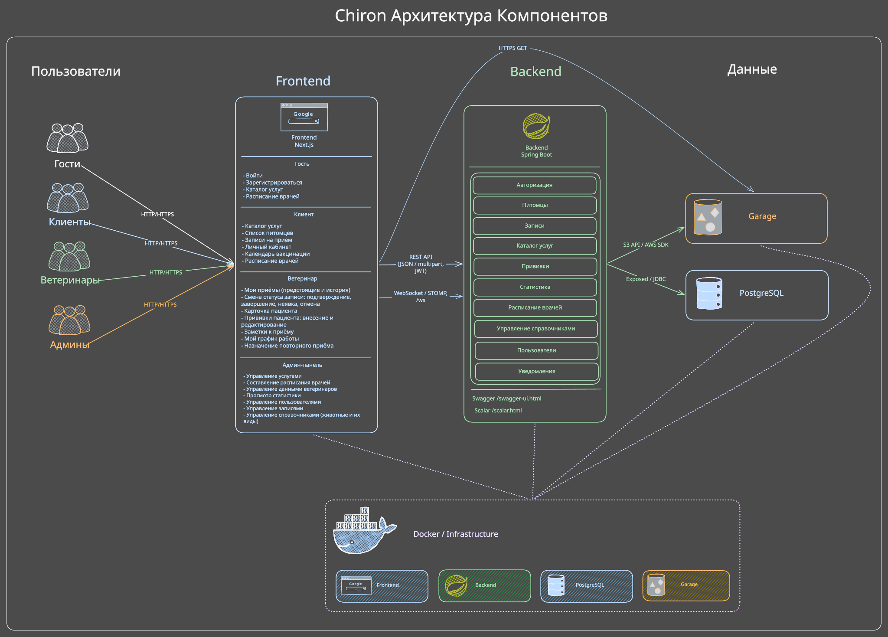
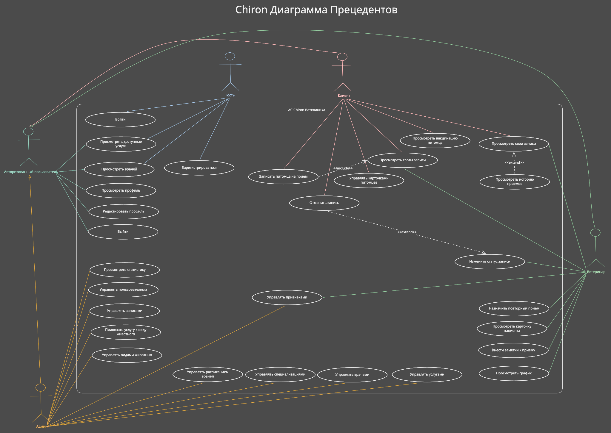

# Chiron

Веб-приложение для ветеринарной клиники: учёт питомцев, запись на приём,
расписания врачей и работа с пациентами. Роли: клиент, ветеринар и администратор.

## Стек

### Бэкенд — `chiron/`

- Kotlin 2.3 и Java 21.
- Spring Boot 4.1, Spring MVC и Bean Validation.
- Spring Security и JWT — авторизация и разграничение доступа.
- Exposed / JDBC и Flyway — доступ к данным и миграции.
- WebSocket / STOMP — уведомления; OpenAPI, Swagger UI и Scalar — документация API.
- AWS SDK for Java — работа с S3-совместимым хранилищем.

### Фронтенд — `web-ui/`

- TypeScript, Next.js 15 (App Router) и React 19.
- Tailwind CSS 4 и собственная дизайн-система.
- Lucide React — SVG-иконки.
- Fetch API — HTTP-запросы; STOMP.js — уведомления.

### Инфраструктура

- Docker и Docker Compose — сборка и запуск окружений.
- PostgreSQL 18 — основная база данных.
- Garage 2.5 — S3-совместимое хранилище файлов.
- Именованные Docker-тома — хранение БД, данных и метаданных Garage.

## Запуск через Docker

Нужен Docker с Compose. Команды выполняются **из корня репозитория**;
Java и Node.js на хосте не требуются. Каждый вариант собирает и запускает
фронтенд, бэкенд, PostgreSQL и Garage.

| Вариант | Назначение | Веб-интерфейс | API |
|---|---|---|---|
| `local` | Локальная работа со своей БД | [localhost:3000](http://localhost:3000) | `localhost:8080` |
| `demo` | Отдельная БД с готовыми тестовыми данными | [localhost:3001](http://localhost:3001) | `localhost:8081` |
| `production` | Развёртывание на сервере за HTTPS-прокси | Публичный домен | `127.0.0.1:8080` |

Во всех вариантах фронтенд работает из production-сборки. Spring-профиль в `local`
и `demo` — `local`, в `production` — `production`. Окружения используют отдельные тома;
`local` и `production` занимают одинаковые порты и одновременно не запускаются без их изменения.

### Local

Скопируйте [`.env.example`](.env.example) в `.env`, задайте собственный `JWT_SECRET`
и пароль первого администратора `ADMIN_PASSWORD`.

```bash
docker compose --env-file .env -f docker/docker-compose.local.yaml up -d --build
```

Откройте [localhost:3000](http://localhost:3000). Вход администратора — `ADMIN_EMAIL`
и `ADMIN_PASSWORD` из `.env`. PostgreSQL доступен на `localhost:5432`.
Миграции Flyway применяются автоматически.

### Demo

`.env` не нужен: параметры заданы в Compose.

```bash
docker compose -f docker/docker-compose.demo.yaml up -d --build
```

Откройте [localhost:3001](http://localhost:3001) после успешного завершения `seed` и `seed-media`.
Демо содержит 600 клиентов, 900 питомцев, восемь врачей и историю приёмов;
на странице входа доступны кнопки быстрого входа.

| Роль | Логин | Пароль |
|---|---|---|
| Администратор | `admin@demo.chiron.local` | `demoAdmin123` |
| Ветеринар | `vet1@seed.chiron.local` … `vet8@seed.chiron.local` | `password123` |
| Клиент | `client1@seed.chiron.local` … `client600@seed.chiron.local` | `password123` |

Демо доступно только с localhost; эти учётные данные предназначены для локального показа.

### Production

Скопируйте [`.env.production.example`](.env.production.example) в `.env.production`.
Заполните JWT-секрет, учётные данные администратора и PostgreSQL, `FRONTEND_ORIGIN`
(публичный HTTPS origin фронтенда без пути и завершающего `/`).
Добавьте параметры Garage: `STORAGE_BUCKET`, `STORAGE_ACCESS_KEY`, `STORAGE_SECRET_KEY`,
`GARAGE_RPC_SECRET` (64 шестнадцатеричных символа) и `STORAGE_PUBLIC_ENDPOINT`
(доступный браузеру HTTPS endpoint S3). Используйте собственные секреты.

```bash
docker compose --env-file .env.production -f docker/docker-compose.production.yaml config --quiet
docker compose --env-file .env.production -f docker/docker-compose.production.yaml up -d --build
```

Фронтенд слушает `127.0.0.1:3000`, API — `127.0.0.1:8080`; порт PostgreSQL не публикуется.
HTTPS reverse proxy настраивается отдельно:

- `/ws` → `http://127.0.0.1:8080/ws` с поддержкой WebSocket Upgrade.
- Остальные пути → `http://127.0.0.1:3000`.
- HTTPS endpoint S3 → `http://127.0.0.1:3900` с сохранением Host, пути и query подписанного запроса.

Документация API в production отключена. `FRONTEND_ORIGIN` встраивается во фронтенд
при сборке: после его смены повторите команду с `--build`. Файлы `.env` и `.env.production`
содержат секреты и исключены из Git.

## Архитектура

### Компоненты и взаимодействие

Браузер обращается к фронтенду Next.js. HTTP-запросы `/api/*` проходят через серверный
прокси фронтенда к Spring Boot, уведомления доставляются через WebSocket / STOMP.
Бэкенд выполняет бизнес-операции, хранит основные данные в PostgreSQL через Exposed,
а файлы — в Garage через S3 API. Браузер получает файлы по подписанным ссылкам.
Все четыре компонента запускаются в общей сети Docker Compose.



### Организация кода

Бэкенд разделён на слои:

- `presentation` — REST-контроллеры, HTTP DTO и WebSocket-канал.
- `application` — сценарии использования: запись на приём, работа с питомцами, расписаниями и уведомлениями.
- `domain` — сущности, правила и интерфейсы репозиториев.
- `infrastructure` — PostgreSQL / Exposed, S3, безопасность, планировщики и конфигурация Spring.

Во фронтенде `src/app` содержит страницы и серверные прокси, `src/modules` — API и типы
предметных областей, `src/shared` — общие компоненты, HTTP-клиент и WebSocket,
`src/context` — состояние авторизации и темы.

### Диаграмма прецедентов



Исходники для редактирования: [архитектура](docs/architecture.excalidraw)
и [диаграмма прецедентов](docs/usecase.excalidraw).

## Документация

- [Руководство по API](docs/api.md).
- [Фронтенд: структура, переменные и запуск для разработки](web-ui/README.md).
- Локальный API: [Scalar](http://localhost:8080/scalar.html),
  [Swagger UI](http://localhost:8080/swagger-ui.html), [OpenAPI JSON](http://localhost:8080/v3/api-docs).
  Для демо используйте порт `8081`.
